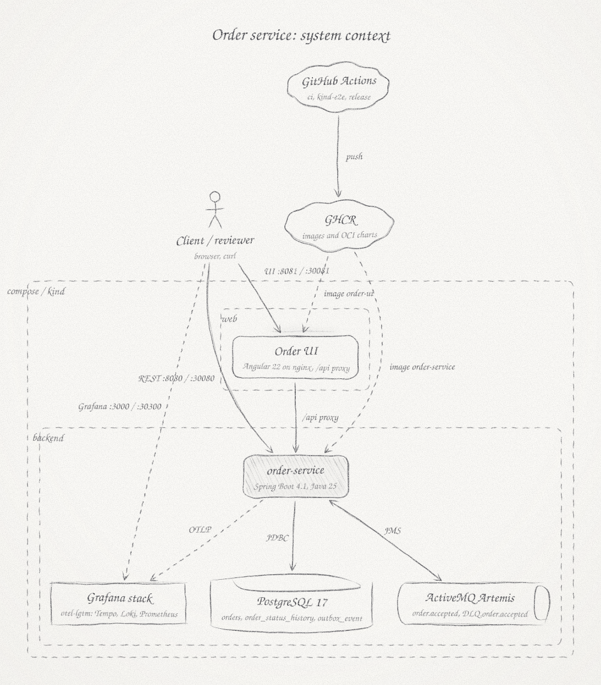
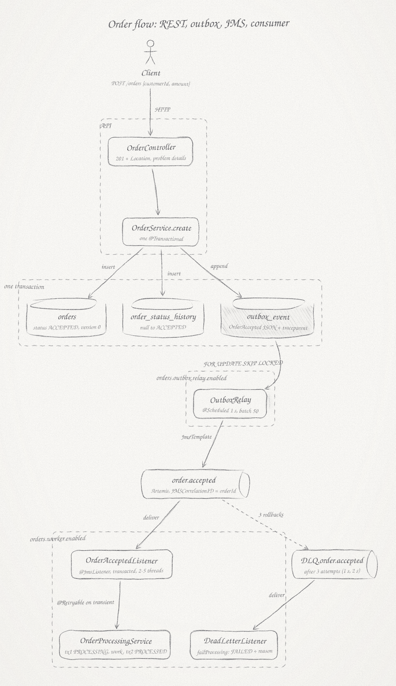
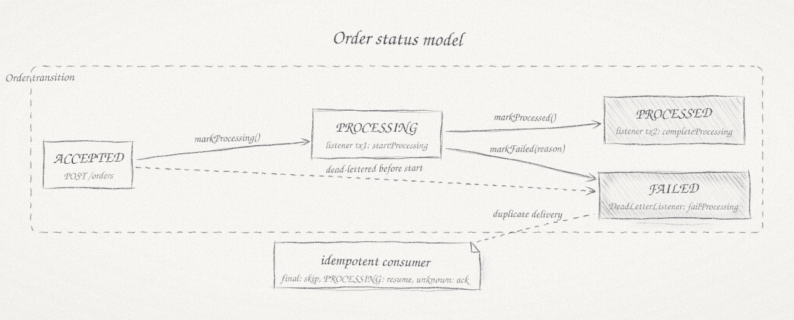
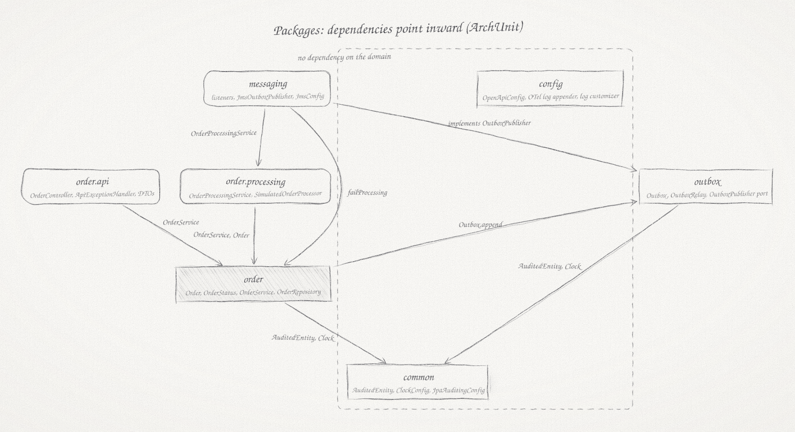
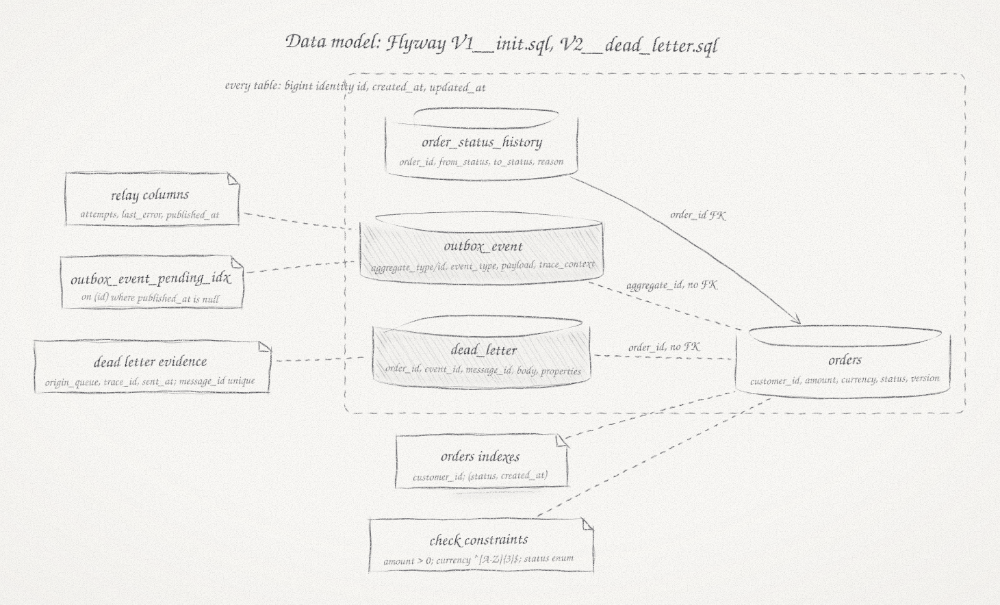
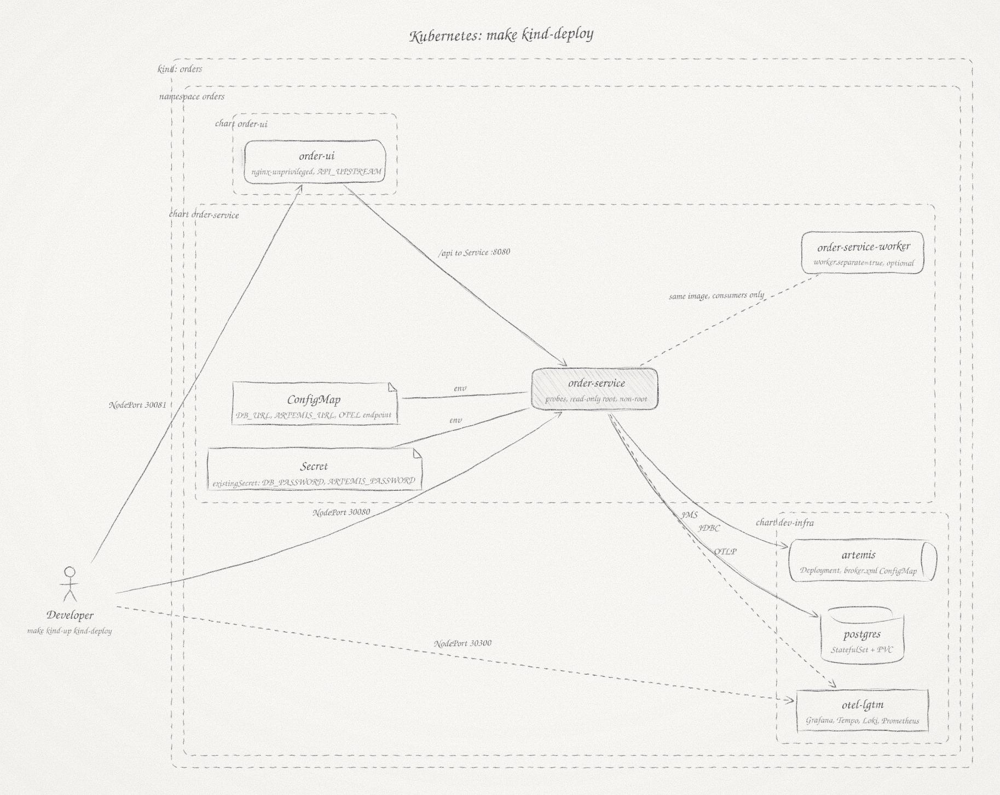
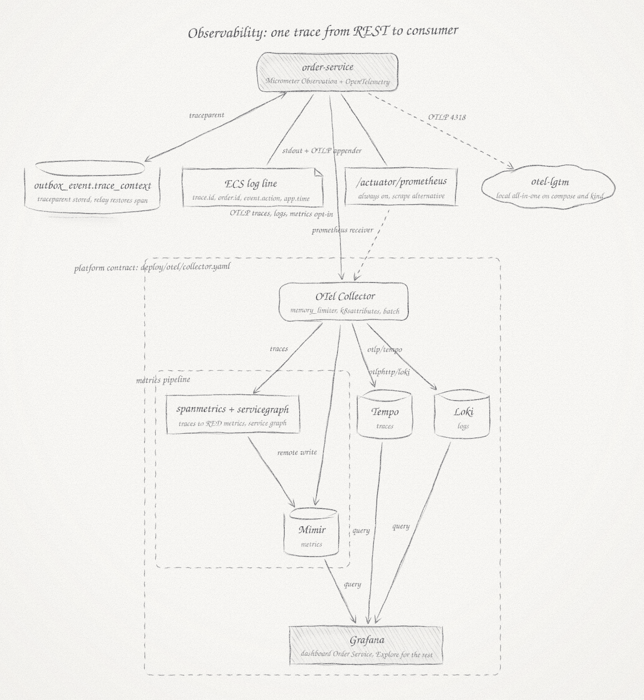
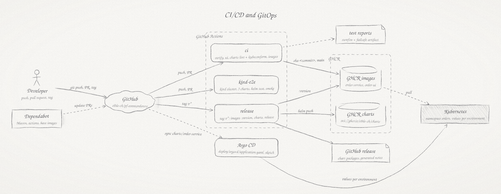

# Architecture diagrams

Eight diagrams, one question each. The sources are the JSON files in `src/`, rendered to SVG with [Penciled](https://github.com/himanshu13ps/penciled) (Node 18 or newer, no dependencies):

```
git clone --depth 1 https://github.com/himanshu13ps/penciled /tmp/penciled
for f in src/*.json; do node /tmp/penciled/skills/penciled/src/cli.js "$f" -o "$(basename "$f" .json).svg"; done
```

| # | Diagram | Question it answers |
|---|---------|---------------------|
| 01 | [context](01-context.svg) | What runs where, who talks to whom |
| 02 | [order flow](02-order-flow.svg) | How an order travels from REST to PROCESSED or FAILED |
| 03 | [status model](03-status-model.svg) | Which transitions exist and who triggers them |
| 04 | [packages](04-packages.svg) | How the code is cut and which dependencies are allowed |
| 05 | [data model](05-data-model.svg) | What the three tables hold and why |
| 06 | [kind deployment](06-deployment-kind.svg) | What `make kind-deploy` puts into the cluster |
| 07 | [observability](07-observability.svg) | How one trace, the logs and the metrics fit together |
| 08 | [CI/CD](08-cicd.svg) | What the pipelines do and how a release reaches a cluster |

## 01 System context



- One deployable, three infrastructure services and one observability container; the same picture on compose (8080, 8081, 3000) and on kind (30080, 30081, 30300).
- The UI is a separate nginx image that proxies `/api`: no CORS, UI and API ship independently.
- The arrow to Artemis points both ways: the service publishes `order.accepted` and consumes it plus the dead-letter queue, from the same image through role toggles.
- GitHub Actions and GHCR sit outside the runtime: the cluster pulls images and charts, nothing pushes into it.
- When the broker is down the API keeps accepting orders; the outbox buffers the events (diagram 02).

## 02 Order flow



- Order, history row and event commit in one database transaction: no event without an order, no order without an event.
- The relay is the only JMS producer; `FOR UPDATE SKIP LOCKED` lets several instances relay without double publishing. Delivery is at least once, so the consumer is idempotent.
- The consumer runs two short transactions around the simulated work: `PROCESSING` is visible, and a crash leaves a state the redelivery resumes.
- Exception path: session rollback, redelivery after 1 s and 2 s, dead-letter queue after three attempts, `DeadLetterListener` marks the order `FAILED` with a reason. Transient errors (`FLAKY-`) are absorbed by `@Retryable` before that.
- The groups are the role toggles `orders.outbox.relay.enabled` and `orders.worker.enabled`: API-only and worker-only instances come from the same image.
- A crash at any arrow: before the commit nothing happened; after the commit the relay picks the event up; after publish but before the acknowledgement the duplicate delivery is skipped.

## 03 Status model



- Four states and four legal transitions, including `ACCEPTED` to `FAILED` for a message dead-lettered before processing started; anything else is an `IllegalStatusTransitionException` and a `409`.
- Transitions live in `Order.markProcessing`, `markProcessed` and `markFailed(reason)` through one private `transition()`; each appends an `order_status_history` row (from, to, reason).
- Final states are shaded: a duplicate delivery for a final order is acknowledged and skipped, `PROCESSING` is resumed, unknown ids are acknowledged.
- `ACCEPTED` instead of the challenge's `CREATED`: one word across status, event, queue, log action and metric.
- Not drawn: the resume of `PROCESSING` and the broker's redelivery loop; neither changes the state.

## 04 Packages



- Arrows are the real imports; `ArchitectureTest` fails the build when one appears in the wrong direction (`domainDoesNotDependOnApi`, `domainDoesNotDependOnProcessing`, `domainDoesNotDependOnMessaging`, `outboxKnowsNoDomain`, `commonIsIndependent`).
- `order` is the core: aggregate, status, service, repository; it knows the outbox port, not JMS.
- `outbox` is generic (aggregate type and id plus payload) and never imports the domain, so it could move to a library.
- `messaging` is the only package that knows JMS: two listeners and the `OutboxPublisher` implementation.
- `common` and `config` depend on nothing of the application; `config` is Spring glue (OpenAPI, the OpenTelemetry log appender, the `app.time` log field), hence no arrow.
- A later split: processing plus the listeners form the worker, api plus relay the API; the toggles already exist.

## 05 Data model



- Three tables, all with `bigint identity` ids and audit columns from JPA auditing fed by the one `Clock`.
- `orders` holds the current state and `version` (optimistic locking); `order_status_history` is append-only (`@Immutable`) with a foreign key; `outbox_event` is generic, so `aggregate_id` has no foreign key.
- The partial index on pending rows keeps the relay query cheap as the table grows; published rows stay as an audit trail, purging is a production step.
- Check constraints mirror the Bean Validation rules: amount above zero, ISO currency, status enumeration. Flyway owns the schema, Hibernate only validates.
- Money as `numeric(19,2)` and `BigDecimal`; `timestamptz` everywhere, UTC.

## 06 Kubernetes deployment (kind)



- `make kind-deploy` builds and loads both images, installs `dev-infra`, `order-service` and `order-ui`, then runs `helm test` and the smoke test over the NodePorts.
- The cluster has one control plane, which maps the NodePorts to the host, and two workers; the service runs two replicas spread over the workers (best effort) with a disruption budget of one, so a drain evicts one API pod at a time while the other keeps serving. The single-instance dev-infra pods are not covered: Postgres is pinned to its node-local volume, and readiness includes the database.
- The service pod runs non-root on a read-only root filesystem with startup, liveness and readiness probes on actuator endpoints, a memory limit without CPU limit, and a config checksum that rolls pods on config changes.
- Secrets never sit in values: `existingSecret` with `DB_PASSWORD` and `ARTEMIS_PASSWORD`; the ConfigMap carries the non-secret environment.
- `worker.separate=true` renders a second Deployment (consumers only) from the same image; the default is one Deployment with both roles.
- `dev-infra` is for development only: Postgres StatefulSet, Artemis with `broker.xml`, otel-lgtm with the provisioned dashboard. Production uses the platform's database, broker and collector through `values-prod.example.yaml`.
- The `kind-e2e` workflow repeats this picture on every push.

## 07 Observability



- One trace from `POST /orders` to the consumer: the outbox row stores `traceparent`, the relay restores it as the span "outbox publish", the JMS message carries it on.
- Traces and logs go over OTLP whenever an endpoint is set; metrics are scraped from `/actuator/prometheus` and optionally pushed over OTLP (`MANAGEMENT_OTLP_METRICS_EXPORT_ENABLED`).
- The collector is the contract with the platform (`deploy/otel/collector.yaml`): `k8sattributes`, batching, `spanmetrics` and `servicegraph` connectors give RED metrics and a service graph without code; Tempo, Mimir and Loki sit behind it.
- A log line is ECS JSON with `trace.id`, `span.id`, `order.id`, the `event.action` vocabulary and `app.time` (business clock): filter Loki by order id, jump to the trace.
- Locally otel-lgtm replaces collector, backends and Grafana in one container; the application configuration is identical (`OTEL_*` variables).
- The dashboard `Order Service` (provisioned from `deploy/grafana/`) puts rates, percentiles, the outbox backlog and the trace plus log lines of one order on one page.
- Resource attributes have one owner: `service.namespace`, `deployment.environment.name` and `service.instance.id` come from the application properties, `DEPLOYMENT_ENVIRONMENT` and `HOSTNAME` (pod name or container id), so two replicas never share a metric series.

## 08 CI/CD and GitOps



- `ci`: Maven verify with Testcontainers, UI lint, test and build, `helm lint` plus kubeconform, then both images to GHCR (`sha-<commit>`, `main`) on `main` only.
- `kind-e2e`: diagram 06 executed on every push: cluster, three charts, `helm test`, smoke test including the UI proxy.
- `release` on tag `v*`: images `:version`, three charts as OCI artifacts, GitHub release with notes. CI has no cluster access.
- GitOps hand-over: Argo CD syncs `charts/order-service` from the repository with per-environment values; a release is an image tag bump in values; the cluster pulls, CI never pushes.
- Dependabot keeps Maven, actions and base images current; Makefile targets mirror the CI jobs, so local equals CI.
- The same stages map onto a GitLab pipeline: build, test, image, lint, e2e, release; kaniko instead of buildx, the Helm OCI push is the same.
